# Knee Osteoarthritis Severity Grading from X-rays — a ResNet ensemble trained from scratch

    

Classifies a knee X-ray into one of the five **Kellgren–Lawrence (KL) grades, G0 to G4**, using four ResNets trained
from random initialisation (**no ImageNet, no pretrained weights of any kind**), label cleaning with CleanLab,
self-supervised rotation pre-training on the project's own images, and a κ-weighted ensemble.

| | |
|---|---|
| **Accuracy** | **65.7 %** on 4,008 test images · **65.9 %** on the official 1,656-image test split |
| **Quadratic κ** | **0.813** on 4,008 images · **0.825** on the official split |
| **Within one grade** | **93.8 %** of predictions are at most one grade away from the truth |
| **Model** | 4 × ResNet, 5.31 M parameters each, trained in about 2.7 h on one Kaggle T4 |

> Research prototype for a university course project (22AIE304 Deep Learning). **Not a medical device.**

---

## What the model predicts: five KL grades (G0 to G4)

The Kellgren–Lawrence scale has **five grades, G0 to G4**. There is no G5. The model outputs one probability per grade.
The picture below shows what each grade looks like and what the model predicted on 25 sample X-rays (green = correct, red = wrong).

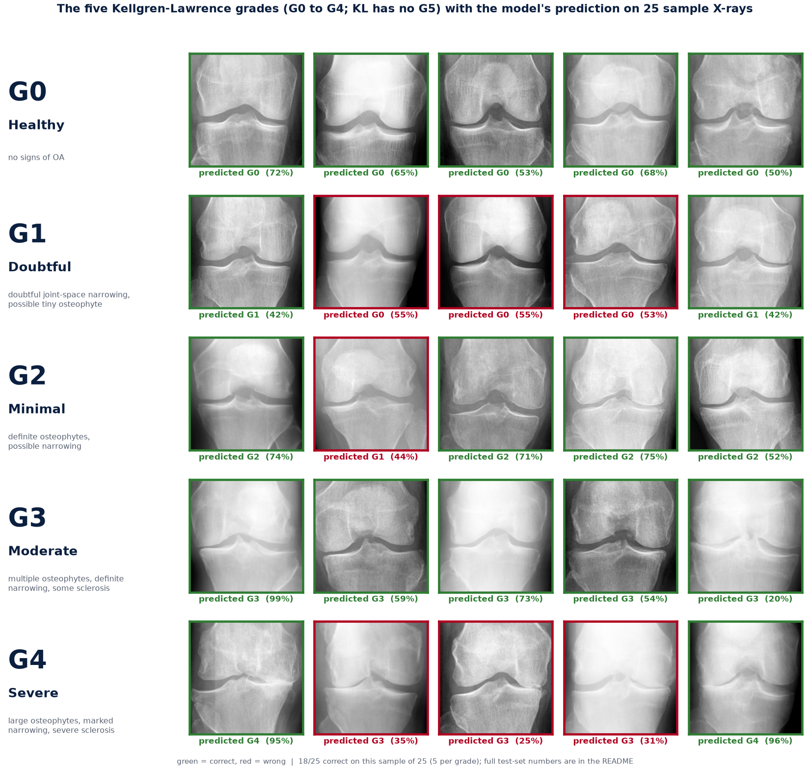

| Grade | Meaning | Test images | Precision | Recall | F1 |
|---|---|---:|---:|---:|---:|
| **G0** Healthy | no signs of osteoarthritis | 1,571 | 0.72 | 0.84 | 0.77 |
| **G1** Doubtful | doubtful joint-space narrowing, possible tiny osteophyte | 724 | 0.32 | 0.30 | 0.31 |
| **G2** Minimal | definite osteophytes, possible narrowing | 1,062 | 0.69 | 0.52 | 0.59 |
| **G3** Moderate | multiple osteophytes, definite narrowing, some sclerosis | 529 | 0.77 | 0.86 | 0.81 |
| **G4** Severe | large osteophytes, marked narrowing, severe sclerosis | 122 | 0.89 | 0.80 | 0.84 |

Per-grade numbers are computed from the final ensemble's confusion matrix on all 4,008 test images
([`assets/per_grade.json`](assets/per_grade.json)).

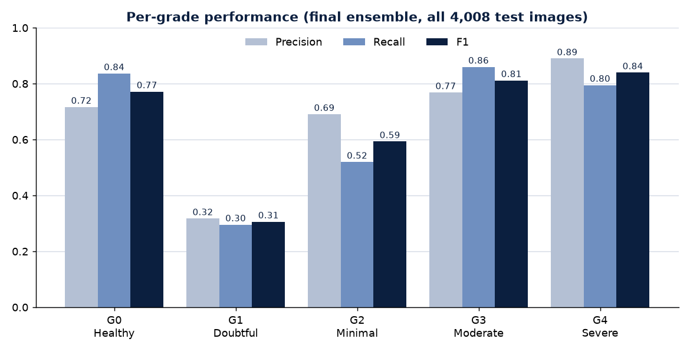

**Reading it honestly.** Moderate (G3) and Severe (G4) knees are found reliably (F1 0.81 and 0.84). The hard cases are the
early grades: **G1 (Doubtful) has F1 0.31** because it is, by definition, hard to tell from G0 and G2, even for people.
Almost all errors are to a *neighbouring* grade, which is why 93.8 % of predictions are within one grade.

---

## Results

### Confusion matrices (rows = true grade, columns = predicted)

Raw ensemble on the left, the final bias-tuned ensemble on the right, both on all 4,008 test images.

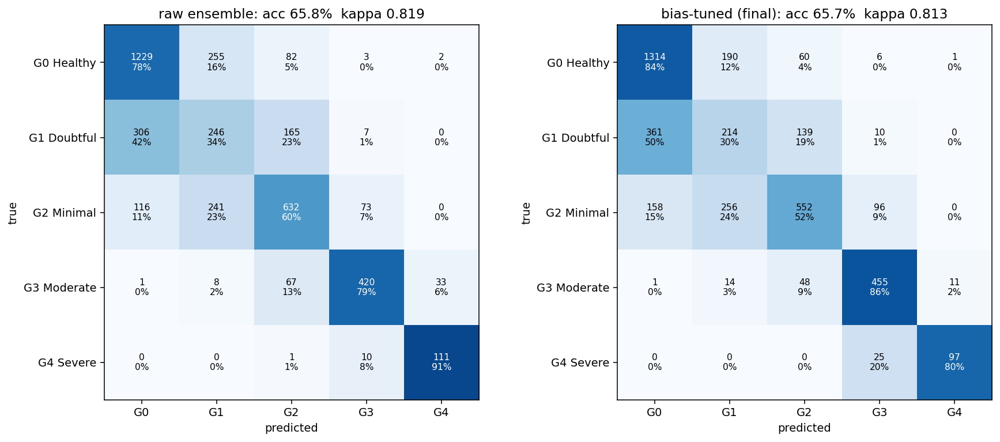

### Full evaluation (scored once on test; nothing was selected or tuned on test)

| Test set | n | Accuracy | Balanced acc. | Macro F1 | Quadratic κ |
|---|---:|---:|---:|---:|---:|
| all test, raw | 4,008 | 65.82 % | 0.684 | 0.672 | 0.819 |
| **all test, bias-tuned (final)** | **4,008** | **65.67 %** | **0.661** | **0.665** | **0.813** |
| official test, raw | 1,656 | 66.61 % | 0.689 | 0.677 | 0.833 |
| **official test, bias-tuned (final)** | **1,656** | **65.94 %** | **0.657** | **0.661** | **0.825** |

"Final" applies a per-class bias tuned on the validation set; "raw" is the plain κ-weighted ensemble. The bias trades a
little accuracy for better balance between grades, so both are reported. Full file: [`results/RESULTS.md`](results/RESULTS.md),
machine-readable: [`results/results.json`](results/results.json), every test prediction: [`results/predictions_all_test.csv`](results/predictions_all_test.csv).

### How it got here

Five iterations on the same 4,008 test images, from the first baseline to this version:

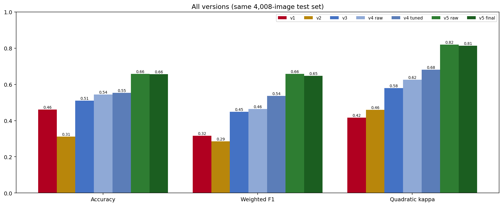

---

## How good is it? Comparison with published work

Studies on the same knee-OA dataset, numbers **as reported by the authors**. This work is the only one in the chart that is
trained **without any pretrained weights** (the other from-scratch model we found does not report accuracy).

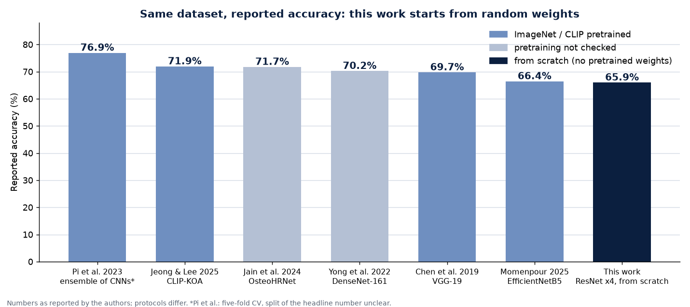

| Work | Model | Pretrained? | Accuracy | Other reported |
|---|---|---|---:|---|
| Chen et al., 2019 | VGG-19 + ordinal loss | Yes (fine-tuned) | 69.7 % | MAE 0.344 |
| Yong et al., 2022 | DenseNet-161 + ordinal regression | Not checked | 70.2 % | – |
| Jain et al., 2024 | OsteoHRNet (multi-scale attention) | Not checked | 71.7 % | – |
| Jeong & Lee, 2025 | CLIP-KOA (CLIP ViT-B/16) | Yes (CLIP) | 71.9 % | F1 0.709 |
| Pi et al., 2023 | Ensemble of CNNs | Yes (ImageNet) | 76.9 % \* | F1 0.767 |
| Momenpour & Abu Mallouh, 2025 | EfficientNetB5 baseline | Yes (ImageNet) | 66.4 % | macro-F1 0.602 |
| afzall003 (GitHub) | Custom CNN, 1.18 M params | **No (from scratch)** | not reported | bal. acc. 0.644, κ 0.753 |
| **This work** | **ResNet × 4 ensemble, 5.31 M params** | **No (from scratch)** | **65.9 %** | **bal. acc. 0.657, macro-F1 0.661, κ 0.825** |

\* Pi et al. use five-fold cross-validation and do not state clearly which split the headline number uses. All other rows use
the 1,656-image official test split as reported. Protocols, label cleaning and metrics differ between studies, so read this as
context, not a leaderboard.

**What the comparison shows**

* **Among from-scratch models, ahead:** balanced accuracy 0.657 and κ 0.825 versus 0.644 and 0.753 for the other from-scratch CNN on the same official test set.
* **Versus pretrained backbones:** 4 to 11 points lower accuracy than the 69.7 – 76.9 % reported with pretrained models, but within 0.5 point of an ImageNet EfficientNetB5 baseline (66.4 %), whose macro-F1 is 0.602 against our 0.661.
* **A fair reading:** pretraining is the key difference. The stronger works start from ImageNet or CLIP weights; ours starts from random weights plus rotation pre-training on our own images.
* The 82 % reported in the 2025 CleanLab paper is scored against *relabelled* test labels and is excluded here as not comparable.

| Our approach vs existing work | |
|---|---|
| 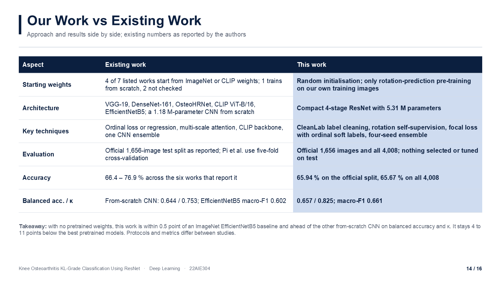 | 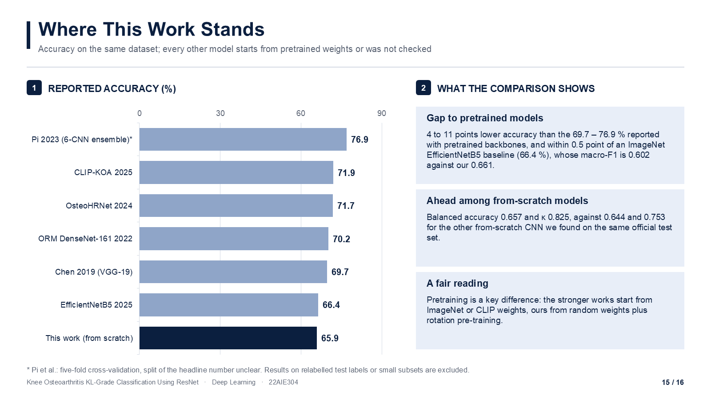 |

---

## Three architectures compared

The training run behind the model selection trained **three architectures × four seeds = 12 models** with the same data and
recipe, and scored all of them on the same 4,008 test images (nothing selected on test).

| Architecture | Parameters | Val κ (mean of 4 seeds) | Test accuracy | Test κ |
|---|---:|---:|---:|---:|
| MixedKernelNet (3×3 / 5×5 conv blocks) | 1.24 M | 0.688 | 54.7 % | 0.655 |
| DenseNet (3 dense blocks, growth 16) | 0.23 M | 0.776 | 62.0 % | 0.752 |
| **ResNet (4 residual stages, 64 → 256 ch.)** | **5.31 M** | **0.811** | **65.5 %** | **0.817** |
| Ensemble of all 12 models, bias-tuned | – | – | 64.72 % | 0.796 |
| Ensemble of 4 ResNets, bias-tuned (**final**) | – | – | **65.67 %** | **0.813** |

ResNet leads MixedKernelNet by 10.8 points of accuracy and wins for every seed; the 12-model ensemble (64.67 % raw) scores
*below* the best single ResNet (65.99 %), so the final model keeps the four ResNets only. The 4-ResNet row comes from a separate
ResNet-only run of the same recipe; before bias tuning the two ensembles score 64.67 % / κ 0.787 (12 models) and 65.82 % / κ 0.819 (4 ResNets).
Notebook: [`notebooks/02_three_architectures_12_models.ipynb`](notebooks/02_three_architectures_12_models.ipynb).

| Comparison table | Per-seed accuracy |
|---|---|
| 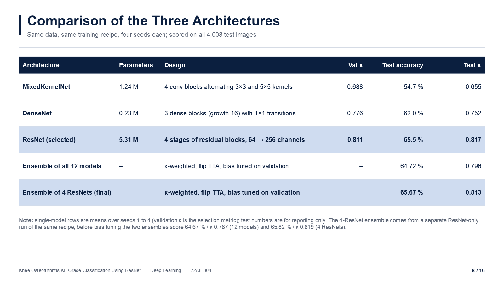 | 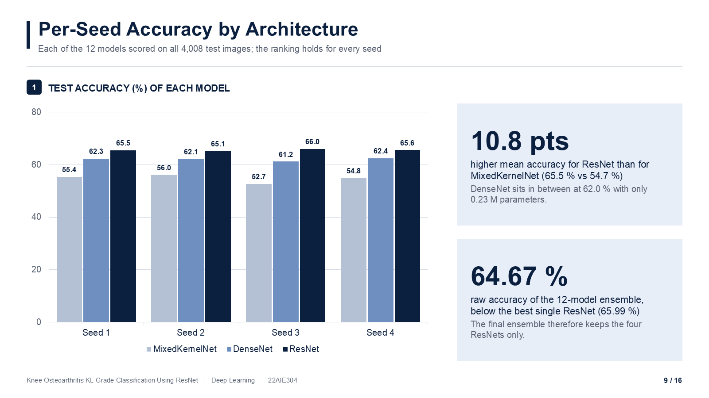 |

---

## Method

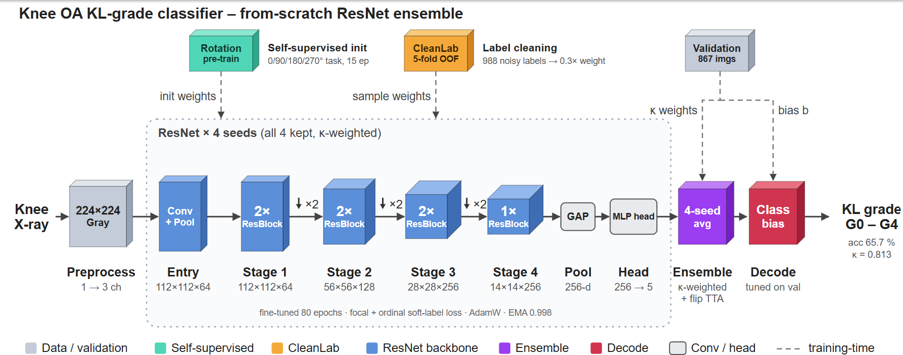

1. **Preprocessing:** grayscale 224×224, replicated to 3 channels, scaled to [−1, 1]; GPU augmentation (rotation ±15°, shift, zoom, flip, gamma/contrast jitter, noise, random erasing).
2. **Label cleaning (CleanLab):** 5-fold out-of-fold predictions flag suspect labels. Flagged samples are **down-weighted to 0.3×, never removed** (988 of 4,911 training labels).
3. **Self-supervised pre-training:** rotation prediction (0° / 90° / 180° / 270°) for 15 epochs on the training images only. No labels, no outside data.
4. **Fine-tuning four ResNet seeds:** 80 epochs, class-weighted focal loss (γ = 2), ordinal soft labels (15 % of the label mass on neighbouring grades), AdamW (lr 1e-3, weight decay 2e-2), 3-epoch warm-up + cosine schedule, weight EMA 0.998; checkpoint chosen by validation κ.
5. **Ensemble and decoding:** κ-weighted average of the four seeds with horizontal-flip test-time augmentation; per-class bias tuned on the validation set only.

The ResNet itself: an entry block (conv + pool), four stages of residual blocks (64 → 128 → 256 → 256 channels, stride-2 convolutions between stages),
global average pooling and a small MLP head, **5.31 M parameters**. Interactive diagram: [`docs/architecture_interactive.html`](docs/architecture_interactive.html).

Data: 4,911 training / 867 validation images (an 85/15 split of the 5,778-image training folder) and 4,008 test images
(the official 1,656-image test split plus the dataset's `auto_test` and `val` folders).

### Training curves (four seeds)

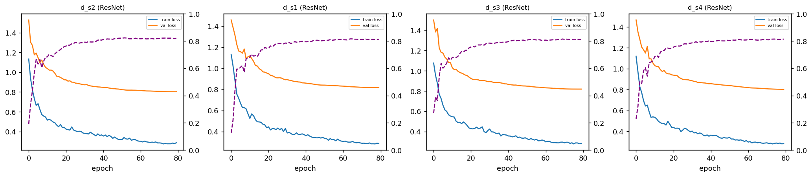

### Where the model looks (Grad-CAM)

The heat-maps concentrate on the joint space between femur and tibia, which is where KL grading looks.

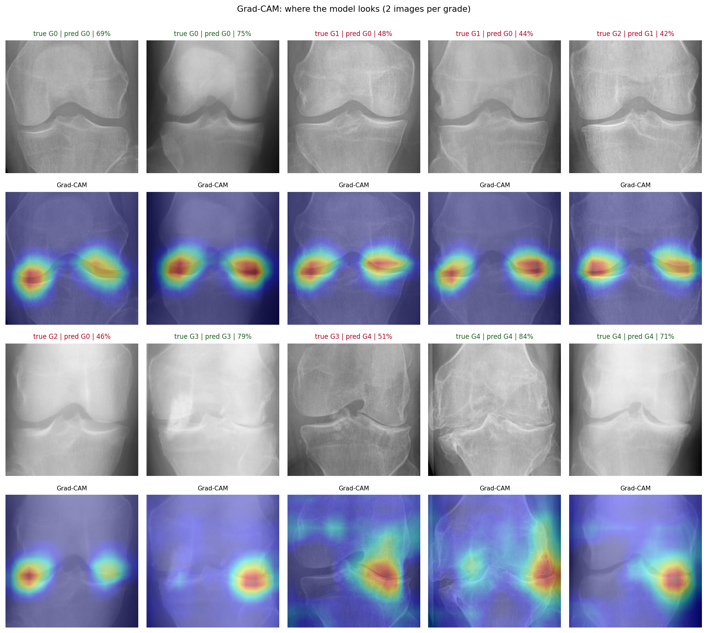

### Failure cases

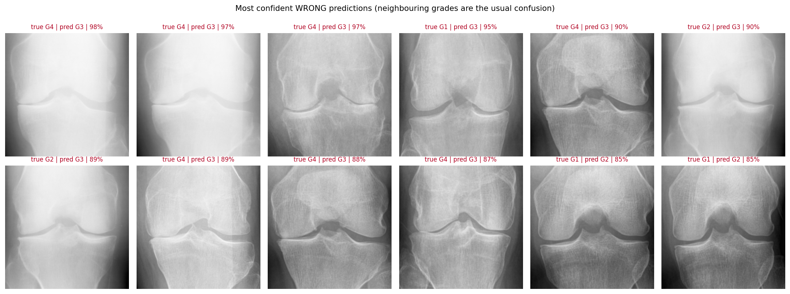

---

## Quick start

```bash
git clone https://github.com/praann07/knee-oa-kl-grading-resnet-scratch.git
cd knee-oa-kl-grading-resnet-scratch
pip install -r requirements.txt

# download the weights bundle from the latest release (85 MB)
curl -L -o knee_oa_model.pt https://github.com/praann07/knee-oa-kl-grading-resnet-scratch/releases/latest/download/knee_oa_model.pt

python predict.py assets/sample_xrays/G3_01.png            # any knee X-ray (png/jpg)
```

It prints the predicted KL grade and the probability of every grade, and saves a PNG with the X-ray, a Grad-CAM heat-map and
probability bars. A CPU is enough; a GPU is used automatically if present. `assets/sample_xrays/` has 25 example X-rays to try and `assets/demo_predictions/` the matching result images from the final model.

> **About the weights.** The release bundle contains the four ResNets selected from the 12-model run
> (raw 65.64 % accuracy / κ 0.819 and bias-tuned 63.67 % / κ 0.816 on the 4,008 test images, same architecture and recipe).
> The numbers headlined above come from the later ResNet-only run (`notebooks/01_resnet_only_final_run.ipynb`), whose weights were not
> exported from Kaggle. Re-run that notebook to reproduce them.

## Reproduce

1. Kaggle → new notebook → *Add Input* → search **"knee osteoarthritis dataset with severity"**. Accelerator: **GPU T4**.
2. Upload and run [`notebooks/01_resnet_only_final_run.ipynb`](notebooks/01_resnet_only_final_run.ipynb) (about 2.7 h; use *Save & Run All (Commit)* so it survives a closed browser).
3. Set `QUICK_TEST = True` at the top of the training cell first for a 3 to 5 minute check.

The three-architecture comparison is [`notebooks/02_three_architectures_12_models.ipynb`](notebooks/02_three_architectures_12_models.ipynb) (about 5 h on a T4). Notebook outputs are stripped to keep the repo small; the results are in [`results/`](results/).

## Repository layout

```
├── README.md
├── predict.py                      # inference + Grad-CAM, 4-model ensemble
├── requirements.txt
├── notebooks/
│   ├── 01_resnet_only_final_run.ipynb          # the final model (4 × ResNet)
│   └── 02_three_architectures_12_models.ipynb  # MixedKernelNet vs DenseNet vs ResNet
├── results/                        # RESULTS.md, results.json, per-image test predictions
├── assets/                         # README figures (+ slides/, sample_xrays/, demo_predictions/)
└── docs/                           # project slides (pptx, pdf) and interactive architecture diagram
```

## Limitations

* One dataset only, no external validation; labels come from the dataset and are noisy (hence the CleanLab step).
* G1 (Doubtful) is weak (F1 0.31) and G2 is moderate (F1 0.59); the model is far better at moderate and severe disease.
* Bias tuning trades a little accuracy for better balance between grades.
* Below the best pretrained ensembles reported in the literature, by design: no pretrained weights were used.
* **Research prototype, not a medical device. Do not use it for diagnosis.**

## Data and credits

* Dataset: *Knee Osteoarthritis Dataset with Severity* (Kaggle mirror by shashwatwork), originally released by P. Chen,
  *Knee Osteoarthritis Severity Grading Dataset*, Mendeley Data (2018). Please check the original dataset page for its terms.
  The few X-ray images in `assets/` are included for demonstration only.
* Compared works: Chen et al. 2019, Yong et al. 2022, Jain et al. 2024, Jeong & Lee 2025, Pi et al. 2023, Momenpour & Abu Mallouh 2025, afzall003 (GitHub), as cited in the table above.
* Label cleaning: [CleanLab](https://github.com/cleanlab/cleanlab).

**Author:** Mamidala Som Praneeth Babu · Amrita Vishwa Vidyapeetham, Coimbatore · Course 22AIE304 Deep Learning

Code released under the [MIT License](LICENSE).
